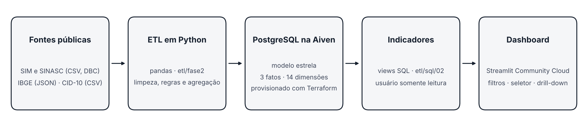

# Painel Epidemiológico de Mortalidade Materna e Violência Obstétrica

Pipeline de dados que trata os microdados públicos do SIM e do SINASC (2022 a 2024), valida os resultados contra fontes oficiais, armazena a base em um PostgreSQL na nuvem (Aiven, plano gratuito) provisionado com Terraform e apresenta os indicadores em um dashboard interativo.

**Disciplina:** Big Data e Analytics · **ODS:** 5 (Igualdade de Gênero) e 18 (Igualdade Étnico-Racial)
**Equipe:** Alison Andrade Rocha, Lívia Alves de Souza e Vitor Carvalho Ferreira
**Dashboard:** [cole aqui o link do Streamlit Cloud]

---

## 1. Arquitetura da solução



Os microdados públicos são tratados por scripts Python, carregados em um PostgreSQL na Aiven em modelo estrela e transformados em indicadores por views SQL. O dashboard em Streamlit consulta essas views a cada interação, com um usuário somente leitura.

---

## 2. Dados utilizados

### Fontes e identificação das bases

- **SIM – Sistema de Informações sobre Mortalidade:** declarações de óbito. Os anos de 2022 e 2023 foram obtidos na página de Transferência de Arquivos do DATASUS (`DOBR2022.dbc` e `DOBR2023.dbc`), e o de 2024 no OpenDataSUS (`DO24OPEN.csv`).
- **SINASC – Sistema de Informações sobre Nascidos Vivos:** declarações de nascido vivo de 2022 a 2024, em CSV, do OpenDataSUS.
- **API de Localidades do IBGE:** nome do município, UF e região, em JSON.
- **CID-10 (DATASUS):** descrição oficial das causas de óbito, em CSV.
- **Dicionários de dados do SIM e do SINASC (Ministério da Saúde):** significado dos códigos de cada variável, em PDF.

### Recorte

- **Período:** 2022 a 2024, os três anos mais recentes já consolidados (o ano de 2025 ainda é preliminar).
- **SIM:** apenas óbitos maternos (mulheres, causa básica no capítulo XV da CID-10 ou marcador O93).
- **SINASC:** todos os nascidos vivos, armazenados como contagens agregadas.

### Características relevantes

- O SIM soma 4.541.891 registros nos três anos (86 a 88 colunas, cerca de 525 MB por ano), e o SINASC, 7.488.823 registros (61 a 62 colunas, cerca de 540 MB por ano).
- Os arquivos são separados por `;`, com encoding `latin-1`, e os campos vêm codificados (ex.: raça/cor `4` = parda).
- A ausência de informação aparece de duas formas: campo vazio e código `9` ("ignorado").
- Os óbitos maternos representam cerca de 0,1% dos óbitos do SIM.

### Classificação dos tipos de dados

- **Estruturados:** microdados do SIM e do SINASC (CSV e DBC) e tabelas da CID-10 (CSV).
- **Semiestruturados:** resposta da API de Localidades do IBGE (JSON).
- **Não estruturados:** dicionários de dados do Ministério da Saúde (PDF), consultados para decodificar as variáveis.

---

## 3. Análise dos 5 V's

- **Volume:** cerca de 12 milhões de registros e 3 GB de arquivos brutos, contra 1 GB de armazenamento no plano gratuito. O ETL filtra apenas os óbitos maternos (4.914 de 4,5 milhões) e agrega o SINASC em contagens (de 7,5 milhões para 1,26 milhão de linhas), sem amostragem.
- **Variedade:** formatos CSV, DBC, JSON e PDF, com layouts diferentes entre os anos (CSVs sem cabeçalho em 2022 e 2023, colunas que só existem em 2024).
- **Velocidade:** as bases são anuais e consolidadas com cerca de um ano de atraso, então o processamento é em lote. Os scripts são reexecutáveis do início ao fim quando sair um novo ano.
- **Veracidade:** padronização dos ignorados, conversão de tipos, regra de óbito materno validada contra a `MAT_CLAS` e totais conferidos com o Painel de Monitoramento da Mortalidade Materna e o TabNet.
- **Valor:** indicadores de mortalidade materna e de violência obstétrica cruzados por raça/cor, idade, escolaridade e território, que mostram desigualdades ligadas às ODS 5 e 18.

---

## 4. Tratamento realizado

A exploração completa, com os resultados de cada verificação, está no notebook `etl/fase2/05_exploracao_bases.ipynb`.

### Problemas identificados

- **SIM 2022 e 2023 sem cabeçalho:** os CSVs desses anos no OpenDataSUS não têm a linha com os nomes das colunas, além de usarem outro formato de data (`21-04-2022`) e terem colunas a mais. O problema foi identificado na comparação das colunas dos três anos e resolvido com os arquivos DBC oficiais do DATASUS, que trazem os nomes das colunas e foram convertidos para CSV.
- **Layout diferente entre os anos:** nomes com caixa diferente (`contador` e `CONTADOR`) e colunas que só existem em 2024, como a `MAT_CLAS`. Os nomes foram padronizados em maiúsculas e só são lidas as colunas usadas, presentes nos três anos.
- **Duas colunas de raça/cor no SINASC:** a `RACACOR` é do recém-nascido e a `RACACORMAE` é da mãe. Foi usada a da mãe.
- **Código O93 no SIM:** não existe na CID-10 internacional. É um código brasileiro para óbito materno associado a causa externa, tratado conforme o protocolo de codificações especiais do Ministério da Saúde.
- **25 causas sem descrição na CID-10 de 2008:** códigos de atualizações posteriores ou registrados só no nível de categoria.
- **19 códigos de município ignorado (UF + `0000`):** não existem no IBGE e foram incluídos na dimensão de municípios para não perder registros.

### Decisões, transformações e justificativas

- **Regra de óbito materno pela CID-10:** seleção dos óbitos femininos com causa básica de O00 a O99 ou com o marcador O93, classificados em "entra na RMM", "tardio" (O96 e O97) e "causa externa". Segue a definição oficial da Razão de Mortalidade Materna (RMM) e não depende da `MAT_CLAS`, que só existe em 2024 e foi usada apenas para validar a regra.
- **Descrição das causas em cascata:** subcategoria da CID-10, depois uma tabela manual com os códigos incluídos pela OMS após 2008 (O98.7 e O14.2) e, por fim, a categoria.
- **Padronização dos ignorados:** vazio, nulo e `9` foram unificados como `9` ("Ignorado"), já que as duas formas têm o mesmo significado.
- **Conversão de tipos:** `DTOBITO` convertida para data; `IDADE` decodificada em anos (`425` = 25 anos); `TPROBSON` (`05`) convertido para inteiro. O código de município foi mantido como texto de 6 caracteres, para preservar zeros e permitir o relacionamento com o IBGE.
- **Faixas etárias e de pré-natal:** idade em faixas de 5 anos, iguais no SIM e no SINASC, para permitir a divisão de óbitos por nascidos; consultas de pré-natal em nenhuma, 1 a 3, 4 a 6 e 7 ou mais.
- **Minimização de dados (LGPD):** foram descartadas datas de nascimento, estabelecimento de saúde, ocupação, naturalidade e horários, que não são usados na análise e poderiam ajudar a reidentificar pessoas.
- **Agregação do SINASC, sem amostragem:** os 7,5 milhões de registros viraram 1,26 milhão de linhas de contagens, sem perder nenhum nascimento. A amostragem eliminaria grupos pequenos nos cruzamentos por raça/cor e território.
- **Dois níveis de agregação no SINASC:** uma tabela por município (denominador da RMM) e outra por UF com as variáveis do parto, já que o detalhe obstétrico por município geraria grupos de 1 ou 2 partos, sem valor analítico.

### Validação

| Ano | Óbitos (projeto) | Óbitos (Painel MS) | Nascidos vivos (projeto) | Nascidos vivos (TabNet) | RMM |
| --- | --- | --- | --- | --- | --- |
| 2022 | 1.370 | 1.368 | 2.561.922 | 2.561.922 | 53,5 |
| 2023 | 1.324 | 1.319 | 2.537.576 | 2.537.576 | 52,2 |
| 2024 | 1.326 | 1.326 | 2.389.325 | 2.389.325 | 55,5 |

Em 2024, os óbitos coincidem com o Painel de Monitoramento da Mortalidade Materna também nas 27 UFs. As diferenças de 2022 e 2023 (até 0,4%) vêm da versão da base: o painel é atualizado continuamente após as investigações de óbito. Consultas em 03/10/2026.

As decisões completas estão no relatório técnico da fase 2 (`docs/relatorio_fase2.pdf`).

---

## 5. Modelagem e escolha do banco

### Relacional ou não relacional

Foi usado um banco **relacional** (PostgreSQL). Os dados são estruturados, os relacionamentos entre óbitos, nascimentos e territórios são fixos e as consultas do painel são agregações (somas e razões por recorte), o que o SQL resolve bem. As chaves estrangeiras garantem a integridade entre fatos e dimensões. Um banco não relacional, como o OpenSearch, faria sentido para busca em textos livres ou documentos JSON de estrutura variável, o que não existe neste projeto.

### Estrutura do banco

Modelo **estrela**: tabelas fato com as medidas e tabelas de dimensão com os recortes. As três fatos compartilham as dimensões de município, faixa etária, raça/cor e escolaridade, o que permite calcular a RMM em qualquer combinação desses recortes.

| Tabela | Cada linha representa | Linhas | Tamanho |
| --- | --- | --- | --- |
| `fato_obito_materno` | um óbito materno | 4.914 | 992 kB |
| `fato_nascidos_municipio` | contagem por ano, município, faixa etária, raça/cor e escolaridade da mãe | 711.592 | 70 MB |
| `fato_nascidos_parto` | contagem por ano, UF, perfil da mãe, tipo de parto, Robson, pré-natal, cesárea antes do trabalho de parto e indução | 553.327 | 65 MB |
| `dim_municipio` e `dim_uf` | município (IBGE + ignorados) e UF | 5.590 e 27 | < 1 MB |
| `dim_causa_obito` | causa de óbito (CID-10) | 269 | 88 kB |
| 11 dimensões de códigos | raça/cor, escolaridade, estado civil, local de ocorrência, momento do óbito, tipo de óbito, tipo de parto, Robson, faixa etária, faixa de pré-natal e sim/não | 3 a 12 cada | < 1 MB |
| `controle_sim`, `controle_sinasc` e `controle_carga` | arquivo de origem e linhas lidas, geradas e carregadas | 3, 3 e 19 | < 1 MB |

As tabelas somam **cerca de 137 MB**; as views materializadas de indicadores acrescentam cerca de 110 MB, e o banco continua abaixo do limite de 1 GB do plano gratuito. Cada fato se liga às dimensões por chave estrangeira, e as fatos de nascidos usam chave primária composta pelas próprias dimensões, garantindo uma linha por combinação.

- Schema completo, com campos, tipos e chaves: `etl/sql/01_schema.sql`
- Diagrama do modelo: `docs/modelo_dados.png`

---

## 6. Regras de negócio e dicionário de dados

### Camada de indicadores

O script `etl/fase3/11_indicadores.py` executa `etl/sql/02_views_indicadores.sql`, que cria:

- `mv_ind_mortalidade` e `mv_ind_parto`: views materializadas com os numeradores e os denominadores de cada indicador, separados, por ano, local, faixa etária, raça/cor e escolaridade.
- `vw_ind_mortalidade`, `vw_ind_parto` e `vw_ind_causas`: as mesmas informações com os nomes das dimensões, consultadas pelo dashboard.

Guardar numerador e denominador separados garante que o painel some os dois no recorte escolhido e só depois divida. Assim, em períodos somados, a taxa é sempre soma das mortes ÷ soma dos nascimentos, e nunca a média das taxas anuais.

### Indicadores

| Indicador | Regra |
| --- | --- |
| Mortes maternas | óbitos com causa básica O00–O99, exceto O96 e O97 (`entra_rmm`) |
| Razão de Mortalidade Materna (RMM) | mortes maternas ÷ nascidos vivos × 100.000, com o mesmo recorte nos dois |
| Risco racial | RMM do grupo de raça/cor ÷ RMM das mulheres brancas |
| Principais causas | mortes de cada causa básica (CID-10) ÷ total de mortes maternas |
| Cesárea | cesáreas ÷ partos com tipo informado |
| Cesárea em baixo risco | cesáreas nos grupos 1 a 4 de Robson ÷ partos com tipo informado nesses grupos |
| Pré-natal completo | nascidos com 7 ou mais consultas ÷ nascidos com consultas informadas |
| Mães adolescentes | nascidos de mães de 10 a 19 anos ÷ total de nascidos |
| Mortes por violência | óbitos com marcador O93.7 (homicídio) e O93.6 (suicídio), em número absoluto e fora da RMM |

### Regras gerais

- Registros com campo ignorado ficam fora do denominador dos percentuais.
- Recortes com menos de 10 mortes aparecem destacados no painel, porque um único caso altera muito a taxa.
- Os indicadores de mortalidade descem até o município; os de parto vão até a UF.
- SIM e SINASC não se ligam por pessoa: não é possível cruzar, por exemplo, o tipo de parto de quem morreu.

### Dicionário das views do painel

| Campo | Descrição |
| --- | --- |
| `ano` | ano do óbito ou do nascimento (2022 a 2024) |
| `regiao`, `uf_sigla`, `uf_nome` | região e unidade da federação de residência |
| `cod_mun_res`, `municipio` | município de residência (código IBGE de 6 dígitos e nome) |
| `faixa_etaria` | idade da mulher em faixas de 5 anos (10-14 a 45-49) |
| `raca_cor` | raça/cor da mulher (branca, preta, parda, amarela, indígena, ignorado) |
| `escolaridade` | escolaridade da mulher (sem escolaridade a superior completo) |
| `nascidos_vivos` | quantidade de nascidos vivos |
| `obitos_rmm` | mortes maternas que entram na RMM |
| `obitos_tardios`, `obitos_causa_externa` | óbitos maternos tardios (O96, O97) e associados a causa externa (O93) |
| `obitos_homicidio`, `obitos_suicidio` | óbitos com marcador O93.7 e O93.6 |
| `cesareas`, `partos_tipo_informado` | cesáreas e partos com tipo informado |
| `cesareas_robson_1a4`, `partos_robson_1a4` | cesáreas e partos nos grupos 1 a 4 de Robson |
| `prenatal_7_mais`, `prenatal_informado` | nascidos com 7 ou mais consultas e com consultas informadas |
| `grupo_causa`, `descricao` | grupo e descrição da causa básica (`vw_ind_causas`) |

---

## 7. Dashboard

**Acesso:** [cole aqui o link do Streamlit Cloud]

Desenvolvido em Streamlit, com gráficos em Plotly, na pasta `dashboard/`. A cada interação, o painel consulta o PostgreSQL da Aiven com o usuário `dashboard_leitura`, que só tem permissão de leitura nas views de indicadores. O cabeçalho mostra o horário da última consulta ao banco.

[inserir print da aba "Mortalidade materna"]

[inserir print da aba "Violência obstétrica"]

### Estrutura

- **Filtros (barra lateral):** período, região, estado, município, raça/cor, faixa etária e escolaridade, aplicados a todos os cards e gráficos.
- **Aba Mortalidade materna:** cards de mortes maternas, risco racial, taxa do estado selecionado (padrão: Bahia) e principal causa; gráficos de mortes por ano, mortes por raça/cor, mapa por estado, ranking com drill-down e 5 principais causas.
- **Aba Violência obstétrica:** cards de cesárea em baixo risco, pré-natal completo, cesárea e mães adolescentes; gráfico por raça/cor com **seletor de métrica** (cesárea em baixo risco, pré-natal completo ou cesárea total), cesárea por ano com o limite da OMS e os 5 estados com mais mães adolescentes.
- **Drill-down:** o ranking passa de regiões para estados e municípios conforme o filtro de região e estado ou com um clique nas barras.

Os cards mostram a variação em relação ao ano anterior (ou 2024 em relação a 2022, quando os três anos estão somados).

O painel não tem filtro de sexo: óbito materno e parto se referem apenas a mulheres, então o recorte interseccional é feito por raça/cor, idade, escolaridade e território.

### Análise dos resultados

**Mortalidade materna acima da meta.** A RMM ficou em 53,5 (2022), 52,2 (2023) e 55,5 (2024) por 100 mil nascidos vivos, quase o dobro da meta brasileira de 30 para 2030 e sem tendência de queda. A região Norte tem a maior taxa (71,3) e o Sul a menor (42,2).

**Desigualdade racial (ODS 18).** Entre 2022 e 2024, a RMM das mulheres indígenas foi de 123,9 por 100 mil, 2,5 vezes a das brancas (49,5). A das mulheres pretas foi de 86,5, 1,75 vez a das brancas; a das pardas, 51,6, próxima à das brancas. Separar pretas e pardas mostra uma desigualdade que o grupo "negras" somado esconde.

**Excesso de cesáreas (ODS 5).** A taxa de cesárea subiu de 58,1% para 60,6% entre 2022 e 2024, quatro vezes o patamar de 10% a 15% acima do qual a OMS não observa benefício na população. Nos grupos de baixo risco de Robson, em que o parto normal seria possível, a taxa foi de 45,7%. O excesso se concentra nas mulheres brancas (53,9%), enquanto as indígenas, que têm a maior mortalidade, ficam em 18,2%. Os dados não mostram a causa, mas o padrão indica desigualdade tanto no excesso de intervenção quanto no acesso.

**Pré-natal.** 78,0% das mães fizeram 7 ou mais consultas, com alta de 4,1 pontos entre 2022 e 2024. A diferença entre grupos é grande: 84,2% entre as brancas e 51,3% entre as indígenas, o mesmo grupo com a maior RMM.

**Mães adolescentes e violência.** 11,9% dos nascidos vivos têm mãe de 10 a 19 anos, com as maiores proporções no Acre (21,4%) e no Amazonas (21,0%). Toda gravidez antes dos 14 anos configura estupro de vulnerável. Entre 2022 e 2024, 31 gestantes e puérperas foram vítimas de homicídio e 14 morreram por suicídio; esses óbitos ficam fora da RMM oficial.

**Limites da análise.** SIM e SINASC não se ligam por pessoa, então não é possível saber, por exemplo, o tipo de parto das mulheres que morreram. Os indicadores de parto vão até a UF. Estados pequenos, como Roraima, têm taxas instáveis por terem poucos casos. Registros com raça/cor ignorada têm RMM menor (26,1), o que indica sub-registro e pode subestimar as desigualdades.

---

## 8. Infraestrutura

- **Serviço:** Aiven for PostgreSQL (PaaS gerenciado).
- **Recursos provisionados:** serviço `pg-saude-materna` (`aiven_pg`) e usuário `dashboard_leitura` (`aiven_pg_user`).
- **Plano:** `free-1-1gb` (1 CPU, 1 GB de RAM e 1 GB de armazenamento, custo zero).
- **Região:** `do-nyc` (DigitalOcean, Nova York).
- **Provisionamento:** Terraform, com o provider oficial `aiven/aiven`.
- **Dashboard:** Streamlit Community Cloud, publicado a partir deste repositório.

Arquivos em `terraform/`:

- `main.tf`: provider da Aiven e recurso do PostgreSQL.
- `dashboard.tf`: usuário somente leitura do dashboard e URL de conexão (marcada como sensível).
- `variables.tf`: token (marcado como sensível), projeto, nome do serviço, plano e região.
- `outputs.tf`: host, porta, plano e URI de conexão (marcada como sensível).
- `terraform.tfvars.example`: modelo dos valores a preencher, sem credenciais.

**Região:** o plano gratuito da Aiven só está disponível nas nuvens DigitalOcean e UpCloud, sem regiões na América do Sul (São Paulo e AWS foram testadas e recusadas pela Aiven). Foi escolhida Nova York, a mais próxima. Os dados armazenados são públicos, anonimizados na origem e agregados no ETL, sem dados pessoais.

O plano gratuito desliga o serviço após um período sem uso. Antes de uma apresentação, o serviço deve ser ligado no console da Aiven (**Power on**); com o banco desligado, o dashboard mostra uma mensagem explicando o que fazer.

**Tecnologias empregadas:** Python 3 (pandas, dbfread, pyreaddbc, psycopg, Streamlit, Plotly), Jupyter Notebook, PostgreSQL, Terraform e Git/GitHub.

---

## 9. Segurança das informações

Nenhuma credencial está no repositório. A estratégia adotada:

- **Token da API da Aiven:** fica em `terraform/terraform.tfvars`, apenas na máquina local, listado no `.gitignore` e declarado como variável `sensitive` no Terraform.
- **Senha e URI do banco:** ficam no `.env` na raiz, gerado a partir do output do Terraform, listado no `.gitignore`. O output é `sensitive` e não aparece no terminal.
- **Estado do Terraform:** os arquivos `terraform/*.tfstate`, que contêm a senha do banco, estão no `.gitignore`, assim como a pasta `terraform/.terraform/`.
- **Dashboard:** usa um usuário próprio, só com permissão de leitura nas views de indicadores. A conexão fica em `.streamlit/secrets.toml` na execução local (no `.gitignore`) e nos **Secrets** do Streamlit Cloud na versão publicada.
- Os scripts leem a conexão do `.env` em tempo de execução; nenhum código contém senha.
- O repositório traz apenas arquivos de exemplo (`terraform.tfvars.example` e `.streamlit/secrets.toml.example`), com valores fictícios.
- **LGPD:** os dados são públicos e anonimizados na origem; o ETL ainda descarta campos que poderiam ajudar a reidentificar pessoas (ver seção 4).

---

## 10. Organização do repositório

```
├── .streamlit/          # tema do dashboard e modelo do secrets.toml
├── dados/
│   ├── brutos/          # arquivos originais (fora do Git pelo tamanho; ver Execução)
│   └── tratados/        # base tratada: fatos, dimensões e controle em CSV
├── dashboard/           # aplicação Streamlit (app.py, dados.py, graficos.py)
├── docs/                # relatório técnico, diagrama do modelo e da arquitetura
├── etl/
│   ├── fase1/           # testes das APIs e extração dos municípios do IBGE
│   ├── fase2/           # notebook de exploração (05) e scripts do ETL (06 a 10)
│   ├── fase3/           # criação das views de indicadores (11)
│   └── sql/             # schema (01), indicadores (02) e permissões (03)
├── terraform/           # infraestrutura como código
├── .gitignore           # credenciais, estado do Terraform e dados brutos
└── README.md
```

Scripts do ETL:

- `etl/fase2/comum.py`: caminhos, anos e regras compartilhadas pelos scripts.
- `etl/fase2/05_exploracao_bases.ipynb`: perfil das bases, testes das regras e conversão DBC → CSV.
- `etl/fase2/06_tratamento_sim.py`: seleção e classificação dos óbitos maternos.
- `etl/fase2/07_tratamento_sinasc.py`: agregação dos nascidos vivos nas duas tabelas fato.
- `etl/fase2/08_dimensoes.py`: 14 dimensões e checagem de integridade referencial.
- `etl/fase2/09_carga_postgres.py`: criação do schema e carga no PostgreSQL.
- `etl/fase2/10_validacao_carga.py`: indicadores recalculados em SQL e comparados com as fontes oficiais.
- `etl/fase3/11_indicadores.py`: views de indicadores, permissões do dashboard e conferência dos valores.

Arquivos do dashboard:

- `app.py`: layout, filtros, cards e gráficos.
- `dados.py`: conexão com o banco e consultas às views.
- `graficos.py`: gráficos em Plotly.
- `assets/br_uf.geojson`: malha das UFs usada no mapa (projeto click_that_hood, da Code for America).

---

## 11. Execução (Deployment Guide)

### Ferramentas e dependências

- Python 3.12 ou superior
- Terraform 1.5 ou superior
- Conta na Aiven, com um token de API
- Conta no GitHub e no Streamlit Community Cloud (para publicar o dashboard)
- No Windows, Microsoft C++ Build Tools (exigido pelo `pyreaddbc`)

```bash
pip install pandas requests jupyter dbfread pyreaddbc "psycopg[binary]"
pip install -r dashboard/requirements.txt
```

### Sequência de execução

1. **Baixar os dados brutos** em `dados/brutos/`:
   - `sinasc_2022.csv`, `sinasc_2023.csv`, `sinasc_2024.csv` e `sim_2024.csv` (OpenDataSUS);
   - `DOBR2022.dbc` e `DOBR2023.dbc` (datasus.saude.gov.br/transferencia-de-arquivos → SIM → Declarações de Óbito → UF BR);
   - tabelas da CID-10 do DATASUS em `dados/brutos/cid10/`.
2. **Gerar a tabela de municípios:**
   ```bash
   python etl/fase1/04_extracao_municipios_ibge.py
   ```
3. **Converter os DBC para CSV:** executar `etl/fase2/05_exploracao_bases.ipynb` até a seção de conversão.
4. **Tratar os dados:**
   ```bash
   python etl/fase2/06_tratamento_sim.py
   python etl/fase2/07_tratamento_sinasc.py
   python etl/fase2/08_dimensoes.py
   ```
5. **Provisionar o banco e o usuário do dashboard:** copiar `terraform/terraform.tfvars.example` para `terraform/terraform.tfvars`, preencher o token e executar:
   ```bash
   cd terraform
   terraform init
   terraform plan
   terraform apply
   ```
6. **Criar o `.env`** na raiz (PowerShell, dentro de `terraform/`):
   ```powershell
   "DATABASE_URL=$(terraform output -raw uri_conexao)" | Out-File -Encoding ascii ..\.env
   ```
7. **Carregar, validar e criar os indicadores:**
   ```bash
   python etl/fase2/09_carga_postgres.py
   python etl/fase2/10_validacao_carga.py
   python etl/fase3/11_indicadores.py
   ```
   O script 09 recria as tabelas a cada execução e apaga as views que dependem delas, por isso o 11 deve ser executado sempre depois dele.
8. **Executar o dashboard localmente:** copiar `.streamlit/secrets.toml.example` para `.streamlit/secrets.toml`, colar a URL obtida com `terraform output -raw dashboard_database_url` e executar:
   ```bash
   streamlit run dashboard/app.py
   ```
9. **Publicar no Streamlit Community Cloud:**
   - em share.streamlit.io, entrar com a conta do GitHub e escolher **Create app → Deploy a public app from GitHub**;
   - repositório deste projeto, branch `main`, arquivo principal `dashboard/app.py`;
   - em **Advanced settings**, escolher Python 3.12 e colar em **Secrets** a linha `DATABASE_URL = "..."` com a mesma URL do passo 8;
   - clicar em **Deploy**. A cada `git push` na branch `main`, o painel é atualizado.